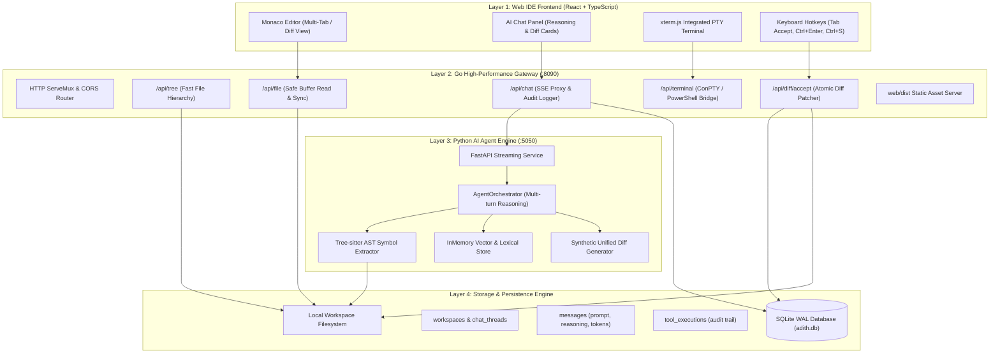

# Adith AI Studio

> **High-Performance Autonomous AI Developer Environment**  
> A full-stack, local-first AI IDE fusing a Go HTTP/WebSocket Gateway, a Python FastAPI Multi-turn Reasoning Engine with Tree-sitter AST parsing, a SQLite WAL persistence engine, and a React Monaco Editor Web interface.

---

## Architecture Overview

Adith AI Studio is architected across four decoupled, high-performance layers designed for ultra-low latency, complete privacy, zero container overhead, and native Windows compatibility.



### The 4 Architectural Layers

1. **Layer 1: TypeScript React Web IDE (`web/`)**
   - **Monaco Code Editor**: Multi-tab editing with automatic syntax highlighting for Go, Python, TypeScript, JavaScript, JSON, Markdown, and more.
   - **Inline Diff Review**: Visual diff preview displaying original vs. modified code with one-click or `Tab` key diff acceptance.
   - **Integrated Terminal**: `xterm.js` terminal connected via binary WebSocket frames directly to local PowerShell / cmd.exe processes.
   - **Live Streaming Chat**: Real-time SSE streaming rendering thought processes in collapsible reasoning containers before response tokens stream.

2. **Layer 2: Go Gateway (`cmd/gateway/`, `internal/`)**
   - **Unified API & Reverse Proxy**: Routes all client requests, proxies AI chat to Python agent, and serves production web assets from `web/dist`.
   - **Safe Filesystem Ops**: Directory traversal checks preventing path escape outside the designated workspace root.
   - **Atomic Diff Patching**: Validates original content match before applying modifications, logging audit records to SQLite.
   - **ConPTY Windows Terminal**: Spawns interactive shells (PowerShell, cmd) with full terminal emulation support.

3. **Layer 3: Python Agent Engine (`agent/`)**
   - **FastAPI SSE Streaming**: Streams events (`reasoning`, `message`, `diff`, `done`) with keep-alive headers and zero buffering (`X-Accel-Buffering: no`).
   - **Tree-sitter AST Parser**: Extracts functions, classes, and method signatures across Python, Go, and TypeScript.
   - **Vector Memory**: In-memory dense and lexical indexing of AST code symbols for semantic retrieval.
   - **Autonomous Patch Generator**: Synthesizes clean unified diffs formatted for one-click application.

4. **Layer 4: Persistent Database & Filesystem (`internal/database/`)**
   - **SQLite in WAL Mode**: Write-Ahead Logging (`PRAGMA journal_mode = WAL`) and `busy_timeout = 5000` for high concurrency without database locks.
   - **Foreign Key Constraints**: Strict cascading integrity on workspaces, chat threads, messages, and tool executions.

---

## Quickstart Guide

### Prerequisites
- **Windows 10 / 11** (64-bit)
- **Go 1.22+**: [Download Go](https://go.dev/dl/)
- **Python 3.10+**: [Download Python](https://www.python.org/)
- **Node.js 18+ & npm**: [Download Node.js](https://nodejs.org/)

### 1-Click Launch (Recommended)

Run the unified PowerShell bootstrapper from the project root:

```powershell
.\run-dev.ps1
```

The bootstrapper automatically:
1. Validates your Python and Go installations.
2. Checks for `web/dist` and compiles the React application if missing.
3. Launches the Python Agent (`:5050`) and waits for `/health`.
4. Launches the Go Gateway (`:8090`) and waits for `/health`.
5. Opens your default web browser to `http://127.0.0.1:8090`.
6. Gracefully terminates all processes and subprocess trees when you press `Ctrl+C`.

#### Customizing Bootstrapper Flags

```powershell
# Run on custom ports
.\run-dev.ps1 -AgentPort 5051 -GatewayPort 8091

# Run without opening the browser automatically
.\run-dev.ps1 -NoBrowser

# Target a different workspace directory
.\run-dev.ps1 -WorkspaceRoot "C:\Projects\MyProject"
```

---

## Manual Execution Workflow

If you prefer running services independently across separate terminal windows:

### 1. Build Frontend
```powershell
cd web
npm install
npm run build
cd ..
```

### 2. Start Python Agent Engine
```powershell
python -m uvicorn agent.server:app --host 127.0.0.1 --port 5050
```

### 3. Start Go Gateway
```powershell
go run cmd/gateway/main.go -port 8090 -agent http://127.0.0.1:5050 -workspace . -db ./adith.db
```

Access the studio at `http://127.0.0.1:8090`.

---

## API Reference

### Go Gateway Endpoints (`http://127.0.0.1:8090`)

| Endpoint | Method | Description |
|---|---|---|
| `/health` | `GET` | Health check returning Gateway status (`{"status":"ok","service":"adith-gateway"}`). |
| `/api/tree` | `GET` | Returns recursive hierarchical file tree of workspace, excluding ignore directories. |
| `/api/file?path=<path>` | `GET` | Reads UTF-8 content of workspace file with traversal bounds check. |
| `/api/diff/accept` | `POST` | Validates original file content, writes patch to disk, logs execution to SQLite. |
| `/api/chat` | `POST` | Proxies prompt to Python Agent via SSE stream; logs interaction to SQLite messages. |
| `/api/terminal` | `GET (WS)` | WebSocket endpoint bridging interactive Windows PTY / PowerShell sessions. |

#### Diff Accept Request Payload
```json
{
  "path": "calculator.py",
  "original": "def add(a, b):\n    return a - b\n",
  "modified": "def add(a, b):\n    return a + b\n"
}
```

#### Diff Accept Response Payload
```json
{
  "status": "applied",
  "path": "calculator.py"
}
```

---

### Python Agent Endpoints (`http://127.0.0.1:5050`)

| Endpoint | Method | Description |
|---|---|---|
| `/health` | `GET` | Agent health probe (`{"status":"ok","service":"adith-ai-agent"}`). |
| `/v1/agent/index` | `POST` | Indexes workspace directory, parses ASTs, and caches code symbols in vector store. |
| `/v1/agent/chat` | `POST` | Executes reasoning loop and streams Server-Sent Events (`text/event-stream`). |

#### SSE Event Specifications

- **`event: reasoning`**: Emitted while the agent searches symbols and evaluates syntax.
  ```json
  {"type": "reasoning", "content": "Analyzing AST for 'calculator.py'..."}
  ```
- **`event: message`**: Conversational prose chunks.
  ```json
  {"type": "message", "content": "I have patched the add function."}
  ```
- **`event: diff`**: Structured code modification proposal.
  ```json
  {
    "type": "diff",
    "data": {
      "path": "calculator.py",
      "original": "...",
      "modified": "...",
      "unified_diff": "@@ -2 +2 @@\n- return a - b\n+ return a + b\n"
    }
  }
  ```
- **`event: done`**: Completion signal containing token metrics.
  ```json
  {"type": "done", "usage": {"prompt_tokens": 14, "completion_tokens": 38}}
  ```

---

## Database Schema & Audit Trail

All workspaces, chat threads, messages, and tool executions are persisted in SQLite with WAL mode (`adith.db`).

```sql
CREATE TABLE workspaces (
    id TEXT PRIMARY KEY,
    name TEXT NOT NULL,
    root_path TEXT NOT NULL,
    default_branch TEXT NOT NULL DEFAULT 'main',
    created_at DATETIME DEFAULT CURRENT_TIMESTAMP
);

CREATE TABLE chat_threads (
    id TEXT PRIMARY KEY,
    workspace_id TEXT NOT NULL,
    title TEXT NOT NULL,
    model_name TEXT NOT NULL,
    created_at DATETIME DEFAULT CURRENT_TIMESTAMP,
    FOREIGN KEY(workspace_id) REFERENCES workspaces(id) ON DELETE CASCADE
);

CREATE TABLE messages (
    id TEXT PRIMARY KEY,
    thread_id TEXT NOT NULL,
    role TEXT NOT NULL,
    content TEXT NOT NULL,
    reasoning_content TEXT,
    prompt_tokens INTEGER,
    completion_tokens INTEGER,
    created_at DATETIME DEFAULT CURRENT_TIMESTAMP,
    FOREIGN KEY(thread_id) REFERENCES chat_threads(id) ON DELETE CASCADE
);

CREATE TABLE tool_executions (
    id TEXT PRIMARY KEY,
    message_id TEXT NOT NULL,
    tool_name TEXT NOT NULL,
    tool_arguments TEXT,
    tool_output TEXT,
    status TEXT NOT NULL,
    duration_ms INTEGER,
    created_at DATETIME DEFAULT CURRENT_TIMESTAMP,
    FOREIGN KEY(message_id) REFERENCES messages(id) ON DELETE CASCADE
);

CREATE TABLE codebase_files (
    id TEXT PRIMARY KEY,
    workspace_id TEXT NOT NULL,
    relative_path TEXT NOT NULL,
    file_hash TEXT NOT NULL,
    ast_parsed BOOLEAN DEFAULT 0,
    indexed_at DATETIME,
    FOREIGN KEY(workspace_id) REFERENCES workspaces(id) ON DELETE CASCADE,
    UNIQUE(workspace_id, relative_path)
);
```

---

## Verification & Test Suites

The codebase includes end-to-end integration tests, unit test suites for all backend packages, Python pytest suites, and frontend type-checking.

### Run All Go Tests
```powershell
go test -v ./...
```

### Run Python Pytest Suite
```powershell
pytest agent/tests
```

### Run Frontend Typecheck & Build
```powershell
cd web
npm run build
cd ..
```

### Run E2E Smoke Test Suite
```powershell
go test -v ./test/...
```

The E2E smoke test verifies:
1. Workspace directory creation and SQLite initialization with WAL pragmas.
2. Codebase file seeding and file tree discovery.
3. Python Agent symbol indexing (`/v1/agent/index`).
4. SSE stream parsing with reasoning, message, and diff events.
5. Atomic diff acceptance (`POST /api/diff/accept`).
6. Filesystem disk modification assertion.
7. SQLite audit trail logging verification in `messages` and `tool_executions`.

---

## Keyboard Shortcuts & Workflow

| Shortcut | Context | Action |
|---|---|---|
| `Tab` | AI Chat / Diff Card | Instantly accepts active proposed diff and writes changes to disk. |
| `Ctrl + Enter` | Chat Input | Submits prompt to AI Agent. |
| `Ctrl + S` | Monaco Editor | Saves currently active editor buffer to workspace file. |
| Click Tab Close (`x`) | Editor Tabs | Closes active tab and focuses adjacent tab. |
| Click File in Tree | File Tree Sidebar | Opens file in new or existing Monaco editor tab. |

---

## Containerization & Kubernetes Migration Path

While designed for native zero-Docker execution on Windows, Adith AI Studio is structured for containerized cloud deployment.

### Dockerfile (Go Gateway + Static Frontend)

```dockerfile
# Multi-stage build for Go Gateway
FROM node:20-alpine AS frontend-builder
WORKDIR /app/web
COPY web/package*.json ./
RUN npm install
COPY web/ ./
RUN npm run build

FROM golang:1.22-alpine AS gateway-builder
WORKDIR /app
COPY go.mod go.sum ./
RUN go mod download
COPY cmd/ cmd/
COPY internal/ internal/
COPY --from=frontend-builder /app/web/dist /app/web/dist
RUN CGO_ENABLED=0 GOOS=linux go build -o /app/adith-gateway cmd/gateway/main.go

FROM alpine:3.19
WORKDIR /app
RUN apk add --no-cache bash ca-certificates
COPY --from=gateway-builder /app/adith-gateway /app/
COPY --from=frontend-builder /app/web/dist /app/web/dist
EXPOSE 8090
ENTRYPOINT ["/app/adith-gateway", "-port", "8090", "-workspace", "/workspace"]
```

### Dockerfile (Python Agent Engine)

```dockerfile
FROM python:3.11-slim
WORKDIR /app
RUN apt-get update && apt-get install -y --no-install-recommends build-essential && rm -rf /var/lib/apt/lists/*
COPY requirements.txt ./
RUN pip install --no-cache-dir -r requirements.txt
COPY agent/ agent/
EXPOSE 5050
ENTRYPOINT ["python", "-m", "uvicorn", "agent.server:app", "--host", "0.0.0.0", "--port", "5050"]
```

### Kubernetes Migration Pattern

- **Deployment 1 (Agent)**: Scalable deployment of Python Agent workers backed by Redis or vector store service (e.g. Qdrant / Milvus).
- **Deployment 2 (Gateway)**: Gateway pods behind an Ingress controller with WebSocket and SSE streaming timeouts disabled.
- **PersistentVolumeClaim**: Shared ReadWriteMany (NFS / CephFS / CSI) mounted at `/workspace` for multi-user project workspaces.
- **Database**: External PostgreSQL or distributed SQLite (LiteFS / rqlite) mapped via the database interface.

---

## License

MIT License. Designed and engineered for high-performance developer workflows.
