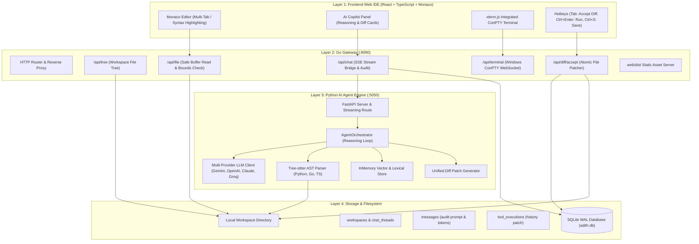

# ⚡ ADITH AI STUDIO

<p align="center">
  <strong>High-Performance Autonomous AI Developer Environment & Local-First IDE</strong><br>
  <em>Dirancang & dikembangkan khusus oleh <strong>Iqbal Aditya</strong> sebagai platform asisten rekayasa perangkat lunak cerdas dan mandiri.</em>
</p>

<p align="center">
  
  
  
  
  
  
</p>

---

## 📖 Ringkasan Proyek (Overview)

**ADITH AI STUDIO** adalah lingkungan pengembangan terintegrasi (*Integrated Development Environment* / IDE) berbasis AI mandiri yang menggabungkan:
1. **Web IDE Modern**: Editor kode Monaco (multi-tab, visual diff patch preview) dan terminal ConPTY bawaan.
2. **Go Gateway Server (:8090)**: Reverse proxy performa tinggi, validasi traversal jalur file yang aman, dan jembatan WebSocket PTY interaktif.
3. **Python AI Agent Engine (:5050)**: Mesin penalaran cerdas (*multi-turn reasoning loop*), ekstraksi simbol berbasis AST (Tree-sitter), memori vektor semantik, dan perute LLM multi-provider.
4. **Penyimpanan SQLite WAL**: Database audit trail untuk mencatat thread obrolan, metrik token, dan eksekusi perubahan file.

Aplikasi ini dapat berjalan secara **100% lokal tanpa container Docker**, sangat hemat sumber daya, dan mendukung berbagai model AI terdepan (Google Gemini, OpenAI GPT-4o, DeepSeek-R1, Anthropic Claude, Groq LLaMA, hingga model offline lokal).

---

## 🌟 Fitur Utama (Key Features)

- 🧠 **Multi-Provider AI Intelligence**:
  - **Google Gemini** (Gemini 2.5 Flash / Gemini 3.1 Flash Lite via official Google AI Studio API).
  - **OpenAI** (GPT-4o, GPT-4o-mini).
  - **DeepSeek** (DeepSeek-R1, DeepSeek-V3).
  - **Anthropic** (Claude 3.5 Sonnet, Claude 3.5 Haiku).
  - **Groq** (LLaMA 3.3 70B Ultra-fast).
  - **Local Ollama & Offline Fallback**: Tetap bisa diajak ngobrol santai, sains, sejarah, dan kalkulasi matematika tanpa koneksi internet.
- ⚡ **Auto Model Router**: Otomatis memetakan model dari dropdown UI ke provider yang aktif tanpa error format model.
- 🔍 **Tree-sitter AST & Vector Memory**: Membaca dan memahami fungsi, kelas, dan struktur kode (Python, Go, TypeScript) secara mendalam.
- 📝 **Visual Diff Proposal & Safe Patching**: Mengusulkan perubahan kode dalam format unified diff yang bisa diterima hanya dengan menekan tombol **`Tab`** atau tombol **Accept Changes**.
- 💻 **Integrated Windows ConPTY Terminal**: Terminal interaktif berbasis `xterm.js` terhubung langsung ke PowerShell / CMD lokal via WebSocket biner.
- 🚀 **1-Click Development Bootstrapper (`run-dev.ps1`)**: Cukup satu perintah untuk menjalankan seluruh stack, memverifikasi dependensi, dan membuka browser otomatis dengan fitur *auto hot-reload*.

---

## 🏗️ Arsitektur Sistem (Architecture)



---

## 🚀 Panduan Memulai Cepat (Quickstart)

### Prasyarat (Prerequisites)
- **Sistem Operasi**: Windows 10 / 11 (64-bit)
- **Go**: 1.22+ ([Unduh Go](https://go.dev/dl/))
- **Python**: 3.10+ ([Unduh Python](https://www.python.org/))
- **Node.js**: 18+ & npm ([Unduh Node.js](https://nodejs.org/))

### 1. Menjalankan Studio (1 Perintah)

Buka PowerShell di folder repositori, lalu jalankan:

```powershell
.\run-dev.ps1
```

Script bootstrapper ini akan:
1. Memeriksa compiler Go, Python, dan Node.js.
2. Memeriksa dan mengompilasi aset frontend React (`web/dist`).
3. Menjalankan Python Agent Engine (`:5050`) dengan fitur *auto-reload*.
4. Menjalankan Go Gateway (`:8090`).
5. Membuka browser otomatis ke `http://127.0.0.1:8090`.
6. Melakukan pembersihan proses (*graceful cleanup*) saat kamu menekan `Ctrl+C`.

---

## 🔑 Konfigurasi API Key (`.env`)

Untuk menghubungkan kecerdasan cloud tingkat tinggi (seperti ChatGPT / Gemini), buat atau edit file `.env` di direktori utama:

```ini
# ==============================================================================
# ADITH AI STUDIO - Model API Keys Configuration
# ==============================================================================

# 1. Google Gemini (GRATIS dari https://aistudio.google.com/app/apikey)
GEMINI_API_KEY=AIzaSy... atau AQ.Ab8...

# 2. Groq (Llama 3.3 70B Super Fast & GRATIS dari https://console.groq.com/)
GROQ_API_KEY=gsk_...

# 3. OpenAI (GPT-4o dari https://platform.openai.com/api-keys)
OPENAI_API_KEY=sk-...

# 4. DeepSeek (DeepSeek-R1 / V3 dari https://platform.deepseek.com/)
DEEPSEEK_API_KEY=sk-...

# 5. Anthropic (Claude 3.5 Sonnet dari https://console.anthropic.com/)
ANTHROPIC_API_KEY=sk-ant-...

# 6. Local Ollama (Jika menjalankan Ollama secara lokal di komputer)
OLLAMA_BASE_URL=http://localhost:11434/v1
```

> 💡 **Tips:** Jika `.env` dibiarkan kosong, ADITH AI STUDIO tetap berjalan menggunakan mesin percakapan lokal internal (sains, matematika, sejarah, tokoh dunia, dan konsep pemrograman).

---

## ⌨️ Pintasan Keyboard (Keyboard Shortcuts)

| Tombol Pintas | Area | Fungsi |
|---|---|---|
| **`Tab`** | Kartu Usulan Diff | Menerapkan usulan perubahan kode langsung ke file asli di disk. |
| **`Ctrl + Enter`** | Input Chat / Editor | Mengirim prompt instruksi ke AI Agent. |
| **`Ctrl + S`** | Monaco Editor | Menyimpan perubahan buffer editor ke file disk. |
| **Klik Tab `x`** | Header Tab | Menutup tab aktif dan berpindah ke tab terdekat. |
| **Klik Berkas di Tree** | Sidebar File Explorer | Membuka file ke tab Monaco Editor. |

---

## 📁 Struktur Direktori (Project Structure)

```text
adith-ai-studio/
├── cmd/
│   └── gateway/
│       └── main.go            # Entrypoint Go Gateway HTTP & WebSocket server
├── internal/
│   ├── api/
│   │   ├── routes.go          # HTTP Mux, REST routes, SSE proxy, dan Terminal WS
│   │   └── terminal.go        # Windows ConPTY terminal bridge
│   ├── database/
│   │   └── sqlite.go          # SQLite schema, migrasi WAL, dan audit logging
│   └── workspace/
│       ├── fileops.go         # Pembacaan file & validasi traversal batas direktori
│       └── diff.go            # Verifikasi konten & penerapan patch diff atomik
├── agent/
│   ├── llm/
│   │   └── client.py          # Multi-provider LLM client & local conversational engine
│   ├── orchestrator.py        # Loop penalaran agen AI & perancang patch diff
│   ├── parser.py              # Parser AST Tree-sitter (Python, Go, TypeScript)
│   ├── memory.py              # Memori vektor semantik simbol kode
│   ├── indexer.py             # Pengindeks hierarki codebase workspace
│   ├── server.py              # FastAPI service untuk SSE streaming & indexing
│   └── tests/                 # Unit test suite Python (pytest)
├── web/
│   ├── src/
│   │   ├── App.tsx            # Komponen utama IDE (Header, layout, tab manager)
│   │   ├── components/
│   │   │   ├── ChatPanel.tsx  # Panel obrolan AI dengan reasoning card & diff proposal
│   │   │   ├── Editor.tsx     # Monaco Editor multi-tab wrapper
│   │   │   ├── FileTree.tsx   # Pohon berkas workspace interaktif
│   │   │   └── Terminal.tsx   # xterm.js terminal emulator
│   │   └── types.ts           # Definisi tipe data TypeScript
│   ├── package.json           # Dependensi React & Vite
│   └── vite.config.ts         # Konfigurasi bundler Vite
├── .env.example               # Contoh template konfigurasi API keys
├── run-dev.ps1                # Script bootstrapper otomatis lokal Windows
├── go.mod                     # Modul Go & dependensi
├── requirements.txt           # Dependensi Python
└── README.md                  # Dokumentasi proyek
```

---

## 🧪 Pengujian & Verifikasi (Test Suites)

Seluruh komponen dilengkapi dengan test suite otomatis:

```powershell
# 1. Jalankan Unit Test Go (20 tests passed)
go test -v ./...

# 2. Jalankan Unit Test Python (34 tests passed)
pytest agent/tests

# 3. Jalankan Type-check & Build Frontend React
cd web
npm run build
cd ..
```

---

## 👤 Penulis & Pengembang (Author)

- **Iqbal Aditya**  
  *Software Engineer & Creator of ADITH AI STUDIO*  
  Portfolio: [Iqbal Aditya Portfolio](https://github.com/iqbaladitya)

---

## 📄 Lisensi (License)

Didistribusikan di bawah lisensi **MIT License**. Bebas dimodifikasi dan dikembangkan untuk kebutuhan pembelajaran maupun produksi.
